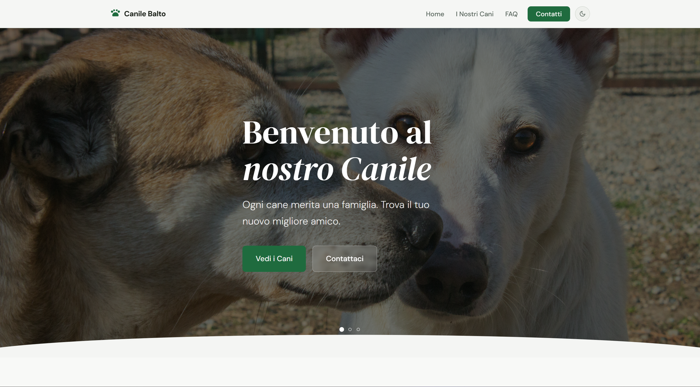
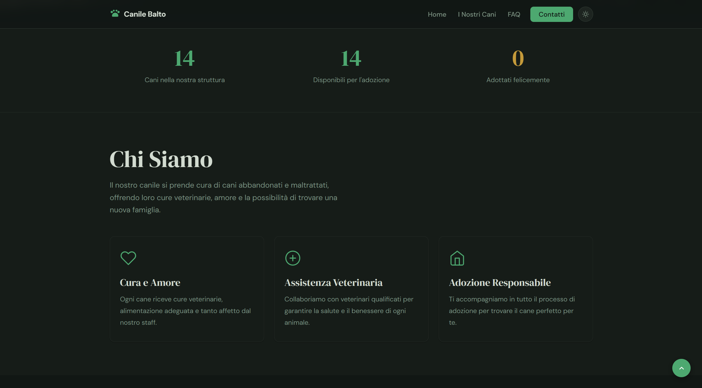
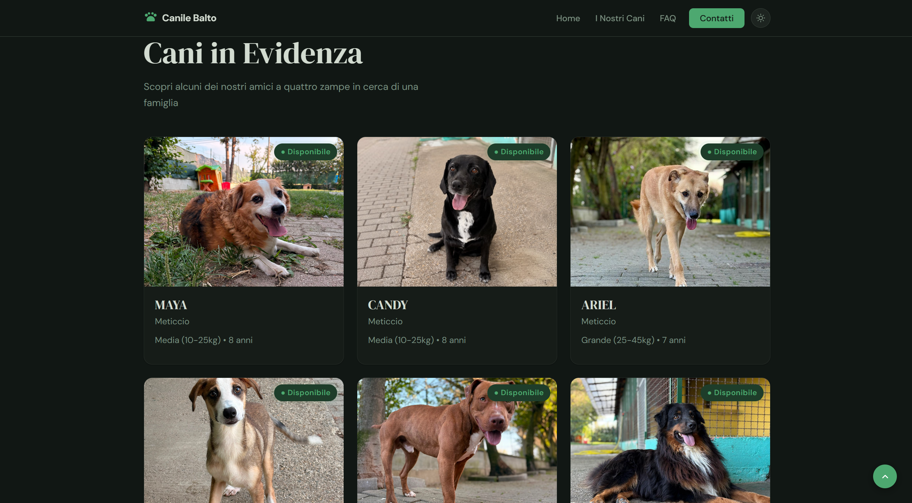
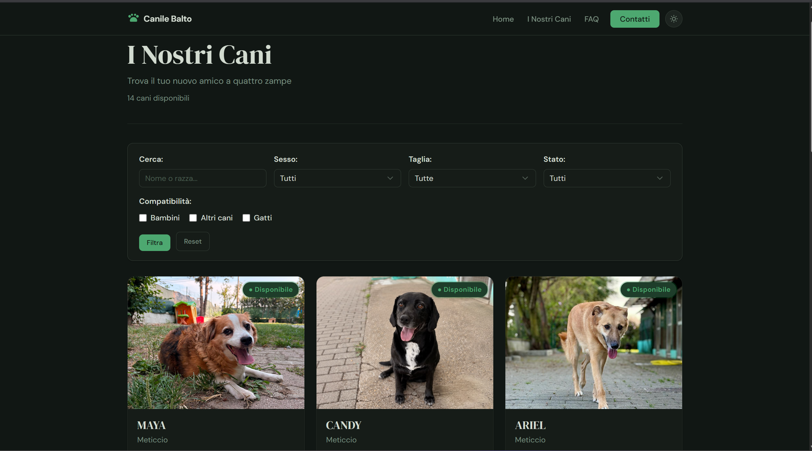
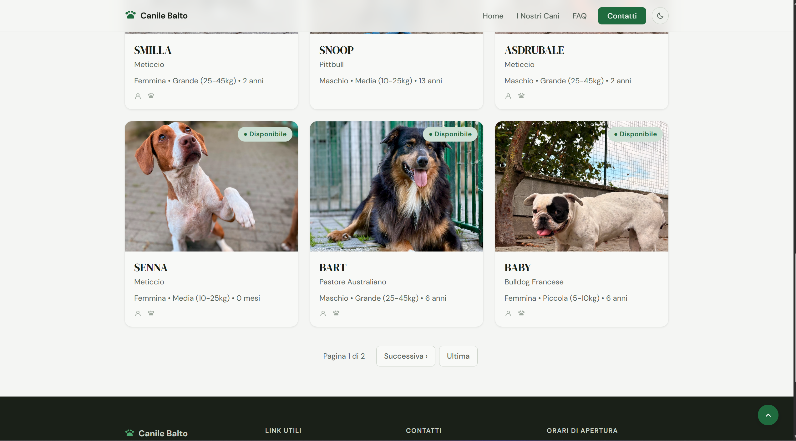
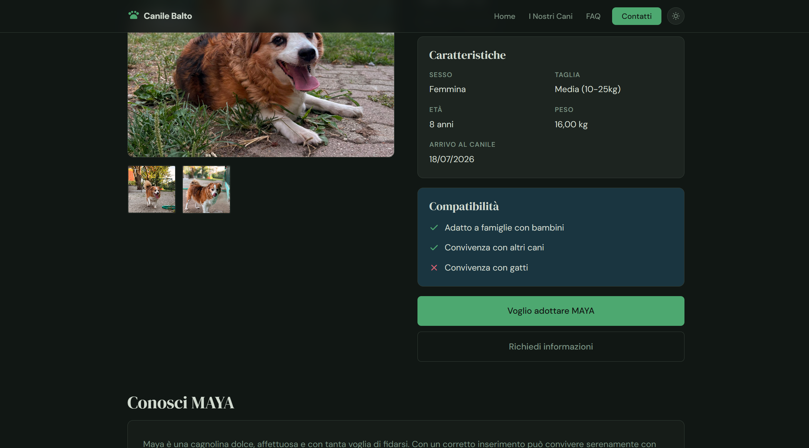
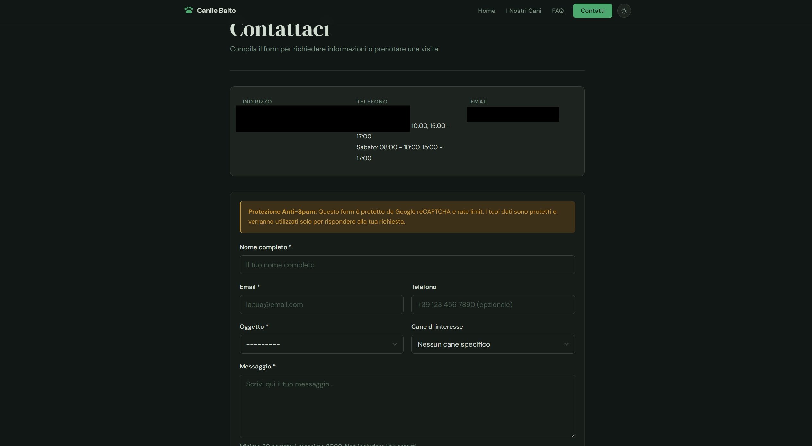

# Animal Shelter WebApp

[](https://github.com/HighMarck17/animal-shelter-webapp/actions/workflows/ci.yml)

An open-source Django platform to manage and showcase adoptable dogs for an
animal shelter. Custom design system (warm palette, mobile-first, no Bootstrap),
production-ready architecture with environment separation, REST API and
multi-layer anti-spam protections.

> **Fork it, fill in one config file with your data, and you have your own
> shelter's website ready to go.**

Licensed under **AGPL-3.0** — see [LICENSE](LICENSE).

---

## Preview

Screenshots from a running deployment of this template (light and dark theme).
The shelter name, photos and data are the ones filled into
`config/shelter_config.py` — a fork renders its own.

### Homepage

Hero with image carousel and the two main calls to action.



Shelter statistics and the "about us" cards, dark theme.



Featured dogs pulled from the database, with availability badge.



### Dog list

Filters by search text, sex, size, status and compatibility, plus pagination.





### Dog detail

Image gallery, physical data, compatibility and the adoption call to action.



### Contact form

Protected by reCAPTCHA, rate limiting and honeypot. Contact details are
redacted in the screenshot.



---

## Fork & customize

This project is a neutral, reusable template. To make it your own you only need
to touch **two files**:

1. **`config/shelter_config.py`** — your shelter's public data: name, tagline,
   contacts, address, opening hours.
2. **`.env`** — secrets and runtime settings (copied from `.env.example`):
   `SECRET_KEY`, database, email/SMTP, reCAPTCHA, Cloudinary.

No application code needs to be edited to rebrand the site.

```bash
git clone <your-fork-url> && cd animal-shelter-webapp
cp .env.example .env          # then fill in secrets
$EDITOR config/shelter_config.py   # then fill in your shelter's data
```

---

## Main features

### Dog list and detail
- Advanced filters: status, size, sex, compatibility (children/dogs/cats), text search
- Detail page: story, image gallery, physical data, suggested similar dogs
- Automatic caching on lists and details

### Protected contact form
- Rate limit: 3 messages/hour per IP
- reCAPTCHA v2
- Honeypot field
- Spam-word filter and disposable email-domain blocking
- Automatic email notification to the staff

### Admin panel
- Manage dogs, breeds, FAQ, contact messages
- Inline image gallery, auto-generated slugs, advanced filters

### REST API
- `/api/v1/dogs/`, `/api/v1/breeds/`, `/api/v1/contacts/`, `/api/v1/faqs/`
- OpenAPI schema at `/api/schema/`, Swagger UI at `/api/docs/`, ReDoc at `/api/redoc/`

---

## Stack

| Component | Version | Usage |
|-----------|---------|-------|
| Python | 3.12.15 (slim-trixie) | Runtime |
| Django | 5.2.18 (LTS) | Web framework |
| Django REST Framework | 3.18.3 | REST API |
| PostgreSQL | 16.15-alpine | Database (prod) |
| SQLite | — | Database (dev/test) |
| Redis | 7.4.11-alpine | Cache and rate limiting (prod) |
| Gunicorn | 26.2.0 | WSGI server |
| nginx | 1.30.5-alpine | Reverse proxy, TLS, static files (prod) |
| WhiteNoise | 6.12.0 | Static files |
| Pillow | 12.3.0 | Image processing / upload validation |
| Cloudinary | 1.46.3 | Media storage (prod) |
| django-ratelimit | 4.1.0 | Rate limiting |
| django-recaptcha | 4.1.0 | reCAPTCHA v2 |
| django-axes | 8.3.1 | Login brute-force protection |
| python-decouple | 3.8 | Environment variables |

---

## Project structure

```
animal-shelter-webapp/
├── apps/
│   ├── core/          — middleware, context processor, abstract base models
│   ├── dogs/          — Dog/Breed/DogImage models, filters, caching, image validators
│   ├── contacts/      — contact form, anti-spam protections, email notifications
│   ├── homepage/      — view with featured dogs and shelter statistics
│   └── faq/           — FAQ by category, frontend accordion
├── config/
│   ├── shelter_config.py — YOUR shelter's data (the file to customize)
│   └── settings/
│       ├── base.py        — common settings
│       ├── development.py — SQLite, LocMemCache, debug toolbar
│       ├── test.py        — SQLite, in-memory email, CAPTCHA test keys
│       ├── test_pg.py     — real PostgreSQL (Docker)
│       └── production.py  — PostgreSQL, Redis, Cloudinary, SSL, logging
├── locale/            — translation catalogs (en example provided)
├── static/            — custom CSS/JS, hero carousel images
├── templates/         — Django templates for each app
├── requirements/      — base.txt / development.txt / production.txt / test.txt
├── Dockerfile         — multi-stage: base / test / production
├── docker-compose.yml — web + db + redis + nginx + certbot + test runner
└── entrypoint.sh      — migrate → collectstatic → gunicorn
```

---

## Local installation

**Prerequisites:** Python 3.12+, Git

```bash
git clone <repo-url> && cd animal-shelter-webapp

python3.12 -m venv venv
source venv/bin/activate

pip install -r requirements/development.txt

cp .env.example .env
# Edit .env with SECRET_KEY, reCAPTCHA credentials, email, etc.
# Edit config/shelter_config.py with your shelter's data.

python manage.py migrate
python manage.py createsuperuser
python manage.py runserver
```

Access: http://localhost:8000 — Admin: http://localhost:8000/admin/

> The development settings ship with sensible defaults, so the app boots
> without a `.env` for a first local look (SQLite, DEBUG on). Fill in `.env`
> before sending email, enabling reCAPTCHA, or going anywhere near production.
> The `dev`/`test` settings are selected by `DJANGO_ENVIRONMENT` (default
> `development`); tests run with a plain `pytest` (see [Tests](#tests)).

---

## Running with Docker

**Prerequisites:** Docker, Docker Compose

```bash
cp .env.example .env
# Edit .env (SECRET_KEY, DB, RECAPTCHA, EMAIL, CLOUDINARY)

docker compose up -d

docker compose exec web python manage.py createsuperuser
```

Access: http://localhost:8000

Useful commands:
```bash
docker compose logs -f web          # live Gunicorn logs
docker compose up -d web            # recreate the container (reloads .env)
docker compose exec web python manage.py shell
```

---

## Internationalization

The UI source strings are in Italian (`msgid`) and wrapped in Django's i18n tags.
The site is served in a single language per deployment, selected via
`LANGUAGE_CODE` in `config/settings/base.py` (default `it-it`).

An English example catalog ships in `locale/en/LC_MESSAGES/`. To serve the site
in English, set `LANGUAGE_CODE = 'en'`. To add or update translations, run:

```bash
django-admin makemessages -l en    # or your language code
# edit locale/<lang>/LC_MESSAGES/django.po
django-admin compilemessages
```

---

## Environment variables

All documented in `.env.example`. Main ones:

```env
DJANGO_ENVIRONMENT=development|test|production
SECRET_KEY=<secret-key>
DEBUG=True|False
ALLOWED_HOSTS=localhost,127.0.0.1

# Database (PostgreSQL in prod)
DB_NAME=shelter_db
DB_USER=shelter_user
DB_PASSWORD=<password>
DB_HOST=localhost
DB_PORT=5432

# Cache (Redis in prod)
REDIS_URL=redis://127.0.0.1:6379/1
REDIS_PASSWORD=<password>   # required by docker-compose.yml

# Email (Brevo SMTP)
EMAIL_HOST=smtp-relay.brevo.com
EMAIL_PORT=587
EMAIL_HOST_USER=<brevo-email>
EMAIL_HOST_PASSWORD=<brevo-smtp-key>
DEFAULT_FROM_EMAIL=noreply@example.org
STAFF_EMAIL=staff@example.org

# Google reCAPTCHA v2
RECAPTCHA_PUBLIC_KEY=<site-key>
RECAPTCHA_PRIVATE_KEY=<secret-key>

# Cloudinary (media in prod)
CLOUDINARY_CLOUD_NAME=<cloud-name>
CLOUDINARY_API_KEY=<api-key>
CLOUDINARY_API_SECRET=<api-secret>

# Security (prod)
CSRF_TRUSTED_ORIGINS=https://your-domain.com
SECURE_SSL_REDIRECT=True
SESSION_COOKIE_SECURE=True
CSRF_COOKIE_SECURE=True
```

> Shelter name, contacts, address and opening hours are **not** environment
> variables — they live in `config/shelter_config.py`.

---

## Environments

| | development | test | production |
|---|---|---|---|
| Database | SQLite | SQLite | PostgreSQL |
| Cache | LocMem | LocMem | Redis |
| Email | SMTP/console | In-memory | Brevo SMTP |
| Media | Filesystem | Filesystem | Cloudinary |
| Debug | True | False | False |
| reCAPTCHA | Test keys | Test keys | Production |

---

## Tests

```bash
# All tests (SQLite)
DJANGO_ENVIRONMENT=test pytest

# With coverage
DJANGO_ENVIRONMENT=test pytest --cov=apps --cov-report=term

# Single app
DJANGO_ENVIRONMENT=test pytest apps/contacts/tests.py -v

# On real PostgreSQL (Docker)
docker compose --profile test run --rm test

# Dependency vulnerability audit (same check as CI)
pip install pip-audit
pip-audit -r requirements/production.txt
pip-audit -r requirements/development.txt
```

### Continuous integration

`.github/workflows/ci.yml` runs on every push to `main`, on every pull request,
weekly (to catch advisories published against unchanged pins) and on demand:

- **pip-audit** on `requirements/production.txt` and `requirements/development.txt`;
  the findings table is published in the job summary and any known
  vulnerability fails the build
- **tests** on Python 3.12 + PostgreSQL 16 (same as the production image) and
  Python 3.13 + SQLite, plus `manage.py check` and a missing-migrations check
- **`check --deploy`** with the production settings (security checks, warnings fail)
- **docker image**: builds the `test` and `production` targets, runs the tests
  inside the test image and smoke-runs the production image (real entrypoint:
  migrate → collectstatic → gunicorn) against PostgreSQL and Redis

---

## Security

- **CSRF** on every form
- **rate limit** 3 req/hour per IP on the contact form
- **reCAPTCHA v2** with server-side verification
- **Honeypot** on the contact form
- **Content validation**: spam words, disposable email-domain blocking, links
- **Security headers**: X-Frame-Options DENY, X-Content-Type-Options, X-XSS-Protection
- **HSTS** (31536000s in production)
- **django-axes**: tracks failed login attempts
- **Client IP**: rate limiting and lockouts use the real client address, read from
  nginx's `X-Real-IP` behind the bundled proxy (`CLIENT_IP_META_KEY`);
  `X-Forwarded-For` is never trusted
- **Dependency audit**: `pip-audit` in CI on every push/PR and weekly
- **Redis**: password required; Lua scripting, admin and dangerous commands denied
- **Image upload**: jpg/png/webp only, max 5 MB (`apps/dogs/validators.py`)

---

## Deploy (Docker + VPS)

```bash
# 1. On the server
git clone <repo-url> && cd animal-shelter-webapp
cp .env.example .env
# Configure .env for production

# 2. Start the stack
docker compose up -d

# 3. Nginx reverse proxy → port 8000
# SSL via Let's Encrypt (Certbot)
```

Minimal `.env` for production:
```env
DJANGO_ENVIRONMENT=production
DEBUG=False
IS_LOCAL=False
SECRET_KEY=<64-char-key>
ALLOWED_HOSTS=your-domain.com,www.your-domain.com
CSRF_TRUSTED_ORIGINS=https://your-domain.com
SECURE_SSL_REDIRECT=True
SESSION_COOKIE_SECURE=True
CSRF_COOKIE_SECURE=True
```

See [DEPLOY.md](DEPLOY.md) for the full guided deployment.

---

## Troubleshooting

| Problem | Solution |
|---------|----------|
| `ModuleNotFoundError: No module named 'django'` | Activate the venv: `source venv/bin/activate` |
| Web container doesn't see new `.env` values | Use `docker compose up -d web` (not `restart`) |
| Cloudinary 403 | Check `CLOUDINARY_*` in `.env` |
| CSRF 403 on form | Add the domain to `CSRF_TRUSTED_ORIGINS` |
| Redis connection error | Check `REDIS_URL` and that the container is running |

---

## Contributing

Contributions are welcome. This project is licensed under AGPL-3.0.

1. Create a branch: `git checkout -b feature/description`
2. Don't commit directly to the default branch
3. Use clear commit messages (Conventional Commits)
4. Run the tests before pushing
